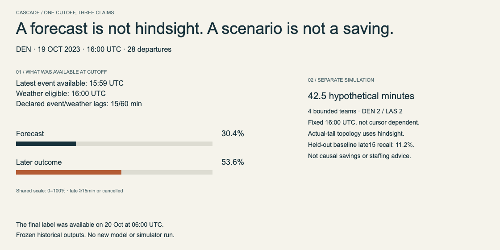
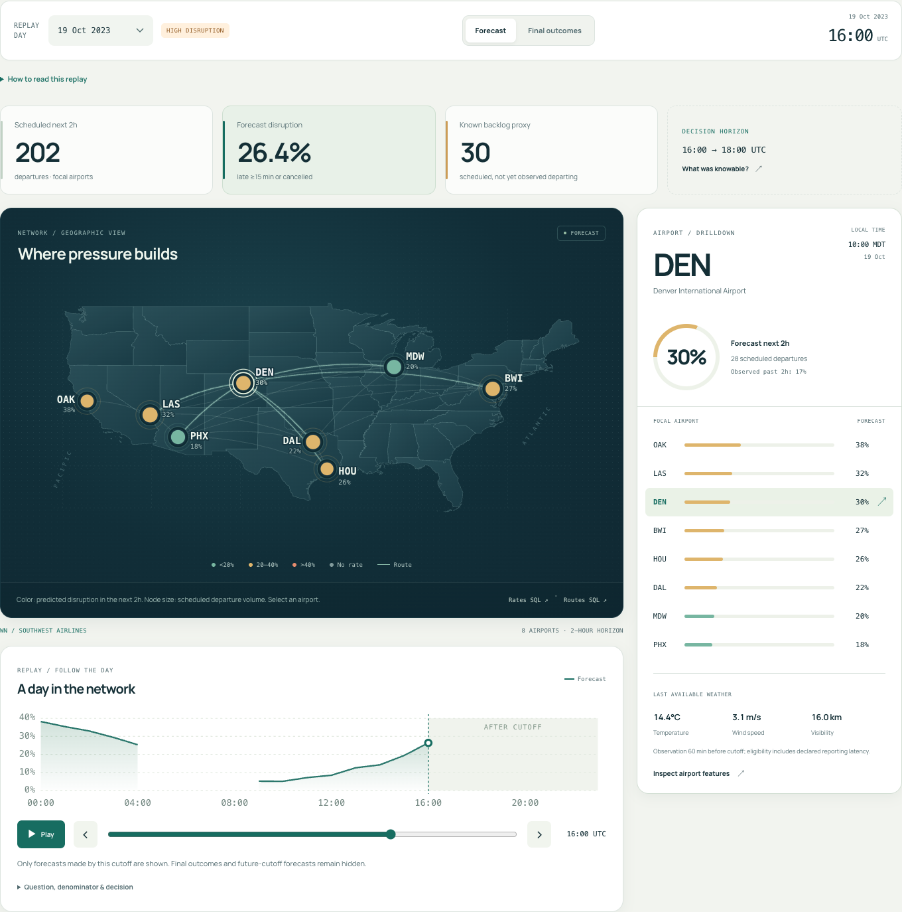

# Cascade

**Reconstruct disruption. Keep forecast, hindsight and intervention separate.**

A local aviation-data warehouse and historical replay. Inspect aircraft continuity, cutoff-aware forecasts and bounded recovery experiments using attributed BTS/NOAA records. No account, API key or live airline feed is required.

<picture>
  <source media="(max-width: 600px)" srcset="docs/presentation/cutoff-mobile.png">
  
</picture>

## Follow one cutoff

At **16:00 UTC on 19 October 2023**, Denver had 28 scheduled departures in the next two hours. The frozen tabular forecast was **30.4%** disrupted; the later final label was **53.6%**. That label matured the next day and was not a cutoff feature. The same day's recovery comparison is an archived hypothetical experiment fixed at 16:00 UTC, independent of the replay clock.

[Read the exact case and limits](docs/presentation/README.md) · [Portable replay and receipt](docs/presentation/cutoff-reader.zip) · [Raw receipt](docs/presentation/receipt.json) · [Actual phone workspace](docs/presentation/app-375.png)

## Run locally

Requires Python 3.12 and [uv](https://docs.astral.sh/uv/). Use the checked lock and bundled 2.5 MiB licensed subset:

```sh
git clone https://github.com/nazeeh111/cascade.git
cd cascade
uv sync --frozen --python 3.12
uv run pytest -q
uv run cascade quickstart
uv run cascade serve --port 0
```

Open the printed loopback URL. Port 0 chooses an available local port; the CLI prints the actual reachable address. The app displays the separately frozen full-run replay. Quickstart rebuilds a different, discontinuous selected-date sample and does not reproduce annual model or recovery findings.

1. Select 19 October 2023, 16:00 UTC and DEN. Inspect the forecast and reporting-lag assumptions.
2. Reveal **Final outcomes** separately. Move the cutoff with the keyboard; the recovery lab still evaluates 16:00 UTC.
3. Compare only the published allocation strategies and fixed four-team budget. Copy the URL to reopen the same day/cutoff/airport/mode/policy in a fresh context.
4. Inspect [continuity SQL](docs/presentation/continuity.sql), its actual [CSV](docs/presentation/continuity.csv) and [JSON](docs/presentation/continuity.json) from the rebuilt sample. Same-tail adjacency is retrospective, not proof of propagation cause.



## Calibration and retained evidence

The current calibration API honors earlier UTC cutoffs for every fitted prior and rejects boundaries beyond the locked test period. See the [calibration date contract](docs/CALIBRATION.md). Archived study results remain frozen outputs of the original implementation. `uv run cascade verify --historical-scenarios` checks portable historical evidence against the locally preserved pinned source bytes without overwriting a report. Its output states whether the current implementation matches; it does not validate the full database or certify current-source compatibility. Bare `cascade verify` remains strict and fails until the frozen scenarios match the current simulation source.

## What this can establish

The tabular model remains the validation-selected model, even though final-test residual comparisons differ. Archived recovery differences are simulator minutes, not causal savings or a real airline plan. Its held-out baseline late15 recall was only 11.2%; actual-tail topology uses hindsight. Crew legality, passengers, gates, maintenance and airspace constraints are missing. No new model fit, simulator study or physical operation was performed for this presentation.

The full original README, all scientific numbers, source selection, negative results and reproduction commands are preserved in the [technical guide](TECHNICAL_GUIDE.md). [Model card](docs/MODEL_CARD.md) · [Original acceptance evidence](docs/ACCEPTANCE.md) · [SQL investigation](reports/EDA.md) · [Source dictionaries](docs/SOURCES.md) · [Interface design](docs/DESIGN.md).

[Live historical replay](https://cascade-flight-intelligence.nazeeh1.chatgpt.site) · [v0.1.0 release](https://github.com/nazeeh111/cascade/releases/tag/v0.1.0) · [Code MIT](LICENSE) · [Data rights and attribution](DATA_LICENSE.md). No airline, airport, BTS or NOAA endorsement is claimed.
