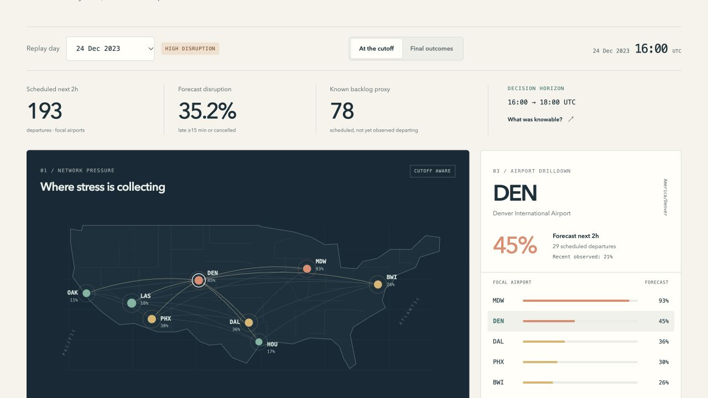

# CASCADE

**Reconstruct disruption. Forecast network pressure. Test a bounded recovery idea.**

CASCADE connects US public flight and weather records to an inspectable two-hour departure-disruption forecast and a constrained recovery experiment. SQL and dbt build the warehouse; statistical models and a small integer optimizer operate on explicit, versioned tables.

[Live replay](https://cascade-flight-intelligence.nazeeh1.chatgpt.site) · [Source dictionaries](docs/SOURCES.md) · [SQL investigation](reports/EDA.md) · [Model card](docs/MODEL_CARD.md) · [Acceptance evidence](docs/ACCEPTANCE.md)

The 2023 study retains **1,438,465 Southwest domestic flights** for aircraft continuity and focuses forecasts on **BWI, DAL, DEN, HOU, LAS, MDW, OAK and PHX**. This is a historical research replay with declared information-availability assumptions. Recovery outcomes are simulated minutes, not causal savings or airline staffing instructions.



## Reproduce

Python 3.12 and [uv](https://docs.astral.sh/uv/) are the recommended local runtime. No API key, account, paid service or source download is needed for the bundled quickstart.

```bash
git clone https://github.com/nazeeh111/cascade.git
cd cascade
uv sync --frozen --python 3.12
uv run pytest -q
uv run cascade quickstart
uv run cascade serve
```

Open the loopback URL printed by `serve`. The app reads a frozen full-run replay; the quickstart separately rebuilds the warehouse from a **2.5 MiB licensed real-data subset**. The sample's selected dates are discontinuous and cannot support annual scientific claims. Its exact selection, per-file rows and checksums are in [data/quickstart/manifest.json](data/quickstart/manifest.json). `quickstart` uses a separate DuckDB file and preserves the full warehouse.

Rebuild all 2023 source data, models, scenarios and the app export:

```bash
uv run cascade full
# Resume already-downloaded, hash-verified partitions:
uv run cascade full --skip-ingest
# Run individual inspectable stages:
uv run cascade warehouse
uv run cascade eda
uv run cascade model
uv run cascade simulate
uv run cascade benchmark
uv run cascade export
uv run cascade verify
```

Source downloads are public and resumable by completed partition. Incomplete bytes never replace a valid partition. The ingestion manifest records hashes of original ZIP/CSV bytes and filtered Parquet, retrieval time, source/scoped counts, cancellations, missing departure delay and signed delay sums. `uv run cascade ingest --refresh` explicitly refreshes sources and preserves changed prior Parquet/manifest bytes under content-addressed `data/history` paths. Manifest writes are atomic; corrupt or incomplete markers trigger a safe re-fetch. A changed snapshot produces a new model data fingerprint and requires regenerated outputs.

## What the system does

- **Warehouse:** raw public snapshots → dbt staging → UTC flights and quality flags → validated retrospective rotations → cutoff-safe airport features and fixed training-period network edges. See [table grains and keys](docs/SCHEMA.md).
- **Investigation:** substantive SQL joins, CTEs, LAG/LEAD, rolling windows, as-of weather, local seasonality, censoring and cohort analysis. Each published finding carries its question, denominator, limitation and decision implication. Read [the evidence notebook](reports/EDA.md) or [its chart view](reports/eda.html).
- **Forecast:** at each hourly UTC cutoff, predict the fraction of scheduled departures in the following two hours that cancel or depart at least 15 minutes late. Compare seasonal, recent-observation, gradient-boosted tabular, temporal residual and graph residual models on chronological dates.
- **Recovery lab:** replay held-out schedules with retrospective actual-tail topology, hard aircraft readiness, an explicit small resource budget and forecast-aware allocation versus simple rules. Check baseline replay error and parameter sensitivity before interpreting any simulated difference.
- **Replay app:** select ordinary or high-disruption held-out days; move the cutoff; inspect the geographic network and airport drilldown; reveal final outcomes separately. Recovery scenarios use a clearly marked 16:00 UTC experiment, independent of the cursor. Source hashes, SQL and model-run reports remain linked.

## What the evidence says

The tabular model was selected on August/September validation and remains the demo model even though the graph variant later performs better on the final holdout. October–December contains **13,492 labeled airport-hour cutoffs** and **92 days**. Calibration, severe-event recall, denominator sensitivities, timing and the paired network contribution are reported in [model_evaluation.json](reports/model_evaluation.json).

Three reproducible descriptive findings illustrate the investigation:

- DEN recorded 35.9% late15-or-cancelled departures, versus 22.1% at HOU in this carrier/year. Airport/route/schedule mix confounds the comparison.
- A validated next departure was late15 in 80.4% of pairs after a late15 inbound, versus 14.0% after an inbound under 15 minutes late. Shared weather and selection on completed legs prevent causal attribution.
- Departure-delay median was 1 minute, mean 11.7 minutes and 99th percentile 147 minutes. There were 592,247 early departures and 17,227 unobserved arrival delays. Missing arrival outcomes remain null.

All figures are generated from [SQL analysis](sql/analysis) and frozen with the released source snapshot. The full findings, including weather association and selection/censoring limits, are in [reports/EDA.md](reports/EDA.md).

## Scale and query performance

The measured ingestion scanned **6,847,899 all-carrier source rows**, retaining the WN scope. Downloads totaled **395,751,334 bytes**; scoped flight/weather Parquet totaled **21,019,683 bytes**. Ingestion wall time on the development Mac was 531.6 seconds; the full dbt build took 242.1 seconds including process/setup overhead. These are observed local measurements, not throughput guarantees.

A January eight-airport latest-weather query compares range-join-plus-ranking with ASOF. Both return the same SHA-256 result; three fresh-connection repetitions show about 135× median speedup and 87% lower DuckDB peak buffer memory. This is a measured subset improvement, not a full-pipeline or process-RSS claim. Inspect [before/after SQL](sql), [EXPLAIN plans and profile JSON](reports/query_benchmark.json) and [warehouse measurements](reports/warehouse_run.json).

## Recovery validation

The deterministic baseline was replayed on 178,864 completed flights across all 92 held-out days: MAE 11.30 minutes, RMSE 25.43 minutes and bias −4.90 minutes. Its delay15 recall was only **11.1%**. This underrepresentation of tail events materially limits operational interpretation.

At a four-team hypothetical budget, mean daily simulated reduction was 22.8 minutes for schedule-volume priority, 26.9 for backlog priority and 31.1 for the forecast-aware optimizer. These are internal simulator differences. They are not measured causal savings, and optimizer scores do not establish an optimal real airline plan. All nine turnaround/shock sensitivity combinations and day-level errors remain visible in [scenarios.json](reports/scenarios.json).

## Boundaries that matter

Final BTS schedules are assumed known before cutoff; historical schedule versions are unavailable. Departure events have an assumed 15-minute observation lag and NOAA observations an assumed 60-minute publication lag. Corrected archival records may differ from what a real-time feed showed. Cancellation announcement times are absent; labels mature retrospectively and cancellation status never enters the cutoff feature matrix.

Actual aircraft assignments are used only for retrospective chains and scenario topology. International/ferry/maintenance movements, passengers, crew legality, gates and airspace restrictions are missing. Same-tail association is not proof of propagation cause. The simulator enforces its stated bounds; those are a small hypothetical experiment, not all real airline constraints. Baseline replay error and negative/inconclusive model comparisons are retained.

## Layout and provenance

| Path | Purpose |
| --- | --- |
| `cascade/ingest.py` | Atomic, hash-verified source partitions and reconciliation |
| `dbt/models`, `dbt/tests` | Substantive SQL transformations and data contracts |
| `sql/analysis` | Rerunnable exploratory questions and cohorts |
| `cascade/modeling.py` | Chronological baseline/tabular/graph comparisons |
| `cascade/simulation.py` | Bounded resource optimization and held-out replay |
| `web/dist` | Buildless, dependency-free browser app and frozen replay |
| `data/source_manifest.json` | Original-source provenance and run scale |
| `data/quickstart` | Small attributed real-data sample |
| `reports` | Scientific results, query profiles, evidence and verification |

Code: MIT. Federal source records: public domain with attribution. Airport metadata: airportsdata MIT. See [DATA_LICENSE.md](DATA_LICENSE.md). No endorsement by airlines, airports, BTS or NOAA is claimed.
